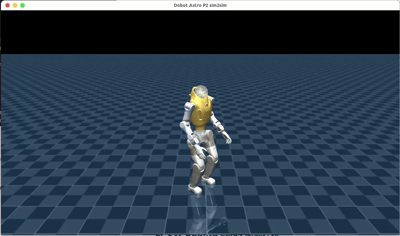
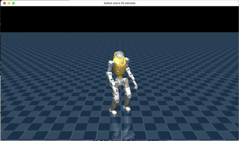
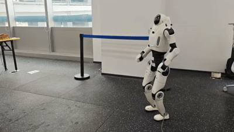
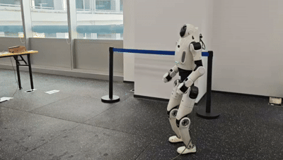
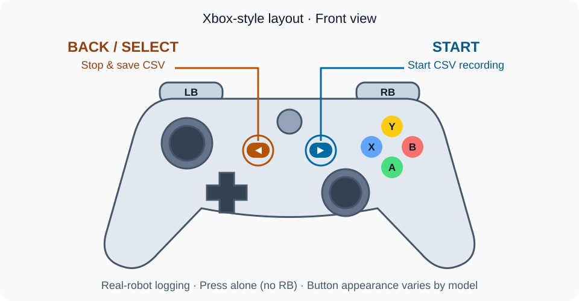

# Dobot Lumo P2 Reinforcement Learning Locomotion Policy Deployment

[中文](README.zh-CN.md) | English

This project provides deployment and simulation for Lumo P2 reinforcement learning locomotion policies. This guide uses Ubuntu 22.04 as an example for setup and usage. It includes two policies:

- `isaaclab_velocity_opensource`
- `mjlab_velocity`

The project provides MuJoCo sim2sim and a sim2real program that runs on the user's computer after it is connected to the robot by Ethernet. Users do not need, and cannot obtain, login access to the robot host.

The Dobot public SDK is maintained in a separate repository and is not included in this project. Validate in simulation before connecting to the real robot.

| isaaclab_velocity_sim2sim | mjlab_velocity_sim2sim |
| --- | --- |
|  |  |
| **isaaclab_velocity_sim2real** | **mjlab_velocity_sim2real** |
|  |  |

## 1. Project layout

```text
assets/        MuJoCo models and meshes
models/        Two ONNX policies
scripts/       Dependency setup, build, and run scripts
src/           Simulation and real-robot programs
tests/         Hardware-free tests
```

Unless otherwise stated, run all commands from the project root:

```bash
cd lumo_p2_locomotion_deploy
```

## 2. Install the base environment (Ubuntu 22.04 example)

```bash
sudo apt update
sudo apt install -y \
  build-essential cmake curl git iproute2 iputils-ping \
  libgl1-mesa-dev xorg-dev
```

These packages provide the C/C++ build tools, dependency download tools, network diagnostics, and the OpenGL/X11 development files required by the MuJoCo window.

Verify the environment:

```bash
cmake --version
c++ --version
uname -m
```

`uname -m` must print `x86_64`. Building and running this project is supported only on the user's x86_64 Linux computer.

## 3. Configure project dependencies

The dependencies are Eigen 3.4.0, ONNX Runtime 1.20.1, MuJoCo 3.2.6, and GLFW 3.4. Choose either method below; do not run both.

### Method 1: run the project script (recommended)

```bash
./scripts/setup_deps.sh
```

The script downloads the fixed versions and installs them under:

```text
.deps/linux-x64/
├── include/
└── lib/
```

Set the dependency path in the current terminal before building:

```bash
export LUMO_DEPS_ROOT="$PWD/.deps/linux-x64"
```

This variable applies only to the current terminal. Set it again in every new terminal.

### Method 2: download archives from the official websites

Download these archives:

- [Eigen 3.4.0](https://gitlab.com/libeigen/eigen/-/releases/3.4.0)
- [ONNX Runtime 1.20.1](https://github.com/microsoft/onnxruntime/releases/tag/v1.20.1), select `linux-x64`
- [MuJoCo 3.2.6](https://github.com/google-deepmind/mujoco/releases/tag/3.2.6), select `linux-x86_64`
- [GLFW 3.4](https://github.com/glfw/glfw/releases/tag/3.4)

Assuming the archives are in `~/Downloads`, run:

```bash
mkdir -p "$PWD/.deps/linux-x64/include/eigen3" \
  "$PWD/.deps/linux-x64/lib"
export LUMO_DEPS_ROOT="$PWD/.deps/linux-x64"

tar -xzf "$HOME/Downloads/eigen-3.4.0.tar.gz" -C /tmp
cp -a /tmp/eigen-3.4.0/Eigen /tmp/eigen-3.4.0/unsupported \
  "$LUMO_DEPS_ROOT/include/eigen3/"

tar -xzf "$HOME/Downloads/onnxruntime-linux-x64-1.20.1.tgz" -C /tmp
cp -a /tmp/onnxruntime-linux-x64-1.20.1/include/. \
  "$LUMO_DEPS_ROOT/include/"
cp -a /tmp/onnxruntime-linux-x64-1.20.1/lib/. \
  "$LUMO_DEPS_ROOT/lib/"

tar -xzf "$HOME/Downloads/mujoco-3.2.6-linux-x86_64.tar.gz" -C /tmp
cp -a /tmp/mujoco-3.2.6/include/. "$LUMO_DEPS_ROOT/include/"
cp -a /tmp/mujoco-3.2.6/lib/. "$LUMO_DEPS_ROOT/lib/"

tar -xzf "$HOME/Downloads/3.4.tar.gz" -C /tmp
cmake -S /tmp/glfw-3.4 -B /tmp/glfw-build \
  -DCMAKE_BUILD_TYPE=Release \
  -DCMAKE_INSTALL_PREFIX="$LUMO_DEPS_ROOT" \
  -DBUILD_SHARED_LIBS=ON \
  -DGLFW_BUILD_EXAMPLES=OFF \
  -DGLFW_BUILD_TESTS=OFF \
  -DGLFW_BUILD_DOCS=OFF \
  -DGLFW_BUILD_WAYLAND=OFF \
  -DGLFW_BUILD_X11=ON
cmake --build /tmp/glfw-build -j"$(nproc)"
cmake --install /tmp/glfw-build
```

Check the required files:

```bash
test -f "$LUMO_DEPS_ROOT/include/eigen3/Eigen/Core"
test -f "$LUMO_DEPS_ROOT/include/mujoco/mujoco.h"
test -f "$LUMO_DEPS_ROOT/include/onnxruntime_cxx_api.h"
test -e "$LUMO_DEPS_ROOT/lib/libglfw.so"
test -e "$LUMO_DEPS_ROOT/lib/libmujoco.so"
test -e "$LUMO_DEPS_ROOT/lib/libonnxruntime.so"
```

No output means all files exist.

## 4. Build and run the MuJoCo sim2sim simulation

Set the dependency path and build:

```bash
export LUMO_DEPS_ROOT="$PWD/.deps/linux-x64"
./scripts/build_sim.sh
```

The script builds `lumo_sim`, then checks the state machine, both ONNX models, and the MuJoCo scene. A successful run should show:

```text
100% tests passed
```

Start the simulation:

```bash
./scripts/run_sim.sh
```

To check only the models and scene without opening a window:

```bash
./build-sim/lumo_sim --check
```

### Simulation controls

| Input | Function |
|---|---|
| `RB + Y` | Reset the physics scene without changing the current mode |
| `RB + A` | Enter the initial pose from any state; interpolation takes about two seconds |
| `RB + X` | Enter damping mode from any state |
| `RB + Up` | Enter IsaacLab after the initial pose is ready, or switch from MJLab |
| `RB + Down` | Enter MJLab after the initial pose is ready, or switch from IsaacLab |
| Left stick | Forward and lateral velocity |
| Right stick | Yaw velocity |

If the robot has fallen in simulation, use this sequence:

1. Press `RB + A` to enter `initial_pose`, then wait about two seconds.
2. Press `RB + Y` to reset the scene and stand the robot up; the current mode remains `initial_pose`.
3. Press `RB + Up` or `RB + Down` to enter a policy.

Without a gamepad, hold `R` in place of `RB`:

- `R+Y` resets the scene; `R+A`, `R+X`, `R+Up`, and `R+Down` switch states.
- `W/S` control forward/backward motion, `A/D` control lateral motion, and `Q/E` control yaw.

## 5. Prepare the local sim2real environment

### 5.1 Prepare the separate Dobot public SDK

Use the x86_64 libraries from the public `dobot-sdk` repository, which require GLIBC ≥ 2.34 and GLIBCXX ≥ 3.4.30. This guide uses Ubuntu 22.04 as an example. Assume the SDK is located at:

```text
/absolute/path/to/dobot-sdk/
```

It must contain at least:

```text
CMakeLists.txt
include/dobot/sdk/session.hpp
include/dobot/robot/sr_3588/
include/dobot/robot/sr_thro/
lib/x86_64/libdobot_sdk.a
lib/x86_64/libdobot_log.so
thirdparty/include/
thirdparty/lib/x86_64/
```

Set the SDK path:

```bash
export LUMO_SDK_ROOT=/absolute/path/to/dobot-sdk
```

The SDK remains independently maintained. Do not copy it into this project or commit it to Git. The build uses the SDK's CMake target and matching Fast DDS, Fast CDR, and logging libraries; the legacy Bridge SDK is no longer used.

### 5.2 Connect the robot by Ethernet

Connect the user's computer to the robot with an Ethernet cable. This project uses `192.168.5.2` as the default robot address:

```bash
ping -c 3 192.168.5.2
```

If it is unreachable, configure the wired interface in Ubuntu to the same `192.168.5.0/24` subnet. For example, use `192.168.5.100` on the computer with subnet mask `255.255.255.0`; do not use the robot's address.

Use this command to check which local interface the system selects:

```bash
ip route get 192.168.5.2
```

The value after `dev` is the interface name, for example `enp8s0`. `run_real.sh` selects this interface from the robot IP automatically, so it is not configured at build time.

If another robot version uses a different address, pass it with `--robot-ip` at startup as described in Section 6. Set `LUMO_DDS_INTERFACE=enp8s0` only when the automatic interface selection is incorrect.

### 5.3 Build the real-robot program on the user's computer

```bash
export LUMO_DEPS_ROOT="$PWD/.deps/linux-x64"
export LUMO_SDK_ROOT=/absolute/path/to/dobot-sdk
./scripts/build_real.sh
```

`build_real.sh` creates `build-real/lumo_real` locally, then runs the hardware-free `--check`. It does not start robot control.

## 6. Start the real-robot program

Before starting, make sure that:

- The robot is securely supported, the emergency stop is available, and no one is nearby.
- The necessary protective measures are in place for the robot.
- The robot is in the debug state that permits external DDS joint control.
- No other program is sending joint commands.
- Ethernet is configured as described above and the computer can reach the robot IP.
- The Ethernet cable is firmly secured and reliably connected to avoid disconnection.
- The computer and network interface have sufficient performance to maintain the required communication rate.

### 6.1 Launch the program

Use `sudo` to launch the real-robot program. The public SDK requests `SCHED_FIFO` at priority `50` for DDS communication threads; insufficient user permissions cause `Problem to set scheduler ... Operation not permitted`. On a normal Ubuntu host, `sudo` usually provides the required permissions without configuring per-user real-time priority limits. Continue building as the ordinary user.

Run in a terminal:

```bash
sudo ./scripts/run_real.sh
```

The default model is `sr_3588` (`192.168.5.2`); the wired interface is selected from its route. Selecting SR_thro changes the default address to `172.16.20.2`:

```bash
sudo ./scripts/run_real.sh --model sr_thro
```

Override the robot address explicitly:

```bash
sudo ./scripts/run_real.sh --robot-ip 192.168.10.2
```

Use `sudo env` to pass environment variables explicitly, avoiding default sudo environment filtering; command-line options take precedence:

```bash
sudo env LUMO_ROBOT_IP=192.168.10.2 ./scripts/run_real.sh
```

Use `--nic enp8s0 --domain 0` to set the interface and DDS domain explicitly. Environment alternatives are `LUMO_ROBOT_MODEL`, `LUMO_DDS_INTERFACE`, and `LUMO_DDS_DOMAIN`; command-line values take precedence.

Enter debug mode manually before starting. The program does not change the robot mode or enable motors. `--robot-ip` selects the route and configures RPC; DDS discovers peers on the NIC/domain, without restricting them to that IP. Use a network/domain dedicated to one robot.

The program starts in damping mode and sends commands only after receiving fresh state and matching both command readers. To stop it, first press `RB + X`, then press `Ctrl+C`, and wait for:

```text
[STOPPED] 程序已退出 / LUMO CONTROL STOPPED
```

Keep the terminal open while the program runs, and follow Section 7 to stop it. Using `sudo` addresses scheduling permission; it does not guarantee a 500 Hz control period or directly fix `missing/stale SDK topic(s)` data timeouts.

### 6.2 Real-robot controls



The diagram shows an Xbox-style layout viewed from the front. **Back / Select is the small button left of center; Start is the small button right of center.** Some controllers label these as View and Menu. Button appearance varies by model; use the corresponding Xbox-mode buttons.

| Input | Function |
|---|---|
| `RB + A` | Enter the initial pose from any state; interpolation takes about two seconds |
| `RB + X` | Enter damping mode from any state |
| `RB + Up` | Enter IsaacLab after the initial pose is ready, or switch from MJLab |
| `RB + Down` | Enter MJLab after the initial pose is ready, or switch from IsaacLab |
| Left stick | Forward and lateral velocity |
| Right stick | Yaw velocity |
| `Start` | Start recording motor diagnostics to CSV |
| `Back / Select` | Stop and save CSV; robot control continues |

First press `RB + A` to enter `initial_pose` and wait for interpolation to finish. Lower the robot from its hoist until both feet contact the floor, then press `RB + Up` or `RB + Down` to enter a policy.

The two policies can switch directly while running, but the robot must remain standing. Never switch policies while walking.

### 6.3 Recording and debugging: CSV and PlotJuggler

Once the program receives valid robot state, press `Start` to record and `Back / Select` to stop and save. Holding a button does not create repeated files; Back wins if both are held. Start does not restart an active recording. Wait for `[CSV] Saved` before pressing Start again to begin a new recording.

Files are saved under the project's `logs/csv/`, for example `lumo_20261104T103000Z_a1B2c3.csv` (UTC filename timestamp with a unique suffix). The terminal reports the full path, saved row count, and dropped sample count. CSV files created under `sudo` are readable by all users, so a normal desktop PlotJuggler process can open them. Git ignores `logs/`.

One sample is attempted per control cycle (target 500 Hz), using actual elapsed seconds from the host's monotonic clock. Each row contains the latest state seen by the control loop, not necessarily a new DDS frame.

| Column | Meaning |
|---|---|
| `time_s` | Seconds since this recording's Start; select as the plot time axis |
| `sample_index` / `dropped_samples` | Sample sequence / cumulative queue-overflow drops in this recording |
| `mode` | 0=damping, 1=initial pose, 2=IsaacLab, 3=MJLab |
| `command_written` | Whether both joint commands were accepted by local DDS; not robot execution acknowledgement |
| `<joint>/q_rad` / `dq_rad_s` | Position / velocity feedback |
| `<joint>/tau_est_nm` | SDK `tau_est` estimated torque feedback; not claimed to be torque-sensor measurement |
| `<joint>/q_cmd_rad` / `dq_cmd_rad_s` | Target position / velocity sent this cycle |
| `<joint>/tau_ff_cmd_nm` | Feedforward torque command, excluding robot-side PD terms |
| `<joint>/kp` / `kd` | Commanded PD gains |

In PlotJuggler, use **Load data from file**, open the CSV, select comma separation and the first row as column names, and choose numeric `time_s` as the time axis. Drag `left_knee_joint/q_rad` and `left_knee_joint/q_cmd_rad` onto one plot to compare tracking, and `left_knee_joint/tau_est_nm` onto another for estimated torque. See the [author's CSV loading example](https://slides.com/davidefaconti/plotjuggler-data).

A fixed-capacity queue separates sampling from CSV formatting and disk writes on a worker thread. If the writer falls behind, new samples are dropped and the saved summary warns about drops; time and sample indices retain gaps. Normal `Ctrl+C` or a detected disconnection saves queued samples after exit damping attempts; the 20 exit damping writes are not included. Forced termination or power loss can lose the final data. Disk errors print `[ERROR] CSV RECORDING FAILED` and disable further recording in this process without changing robot control mode.

## 7. Stop the real-robot program

First press `RB + X` to enter damping mode, then press `Ctrl+C` in the terminal running the program. Wait for the following message and for the shell prompt to return:

```text
[STOPPED] 程序已退出 / LUMO CONTROL STOPPED
```

## 8. Replace a policy

The model files are:

```text
models/isaaclab_velocity_opensource/policy.onnx
models/mjlab_velocity/policy.onnx
```

The fixed interfaces are:

- IsaacLab: `obs[1,480] -> actions[1,29]`
- MJLab: `obs[1,98] -> actions[1,29]`

When replacing a model, the input/output names and dimensions, observation order and history, joint order, default pose, PD gains, and action scale must all match. Restart the corresponding program after replacement.

## 9. Troubleshooting

### A dependency or SDK variable is not set

```bash
export LUMO_DEPS_ROOT="$PWD/.deps/linux-x64"
export LUMO_SDK_ROOT=/absolute/path/to/dobot-sdk
```

Set these two build variables again in every new terminal. The robot IP and interface are selected at startup and do not require a rebuild.

### The robot cannot be pinged after connecting Ethernet

```bash
ip -brief address
ip route get 192.168.5.2
ping -c 3 192.168.5.2
```

Check the cable, interface state, computer address, and subnet mask. The computer and robot must be on the same subnet. If the robot does not use the default address, replace it in these commands and start with `sudo ./scripts/run_real.sh --robot-ip ACTUAL_IP`.

### Disconnection or abnormal exit during control

State timeouts and command transmission failures immediately print a bordered `[ERROR] CONTROL ABORTED` banner (with a Chinese label). After SDK object cleanup, a second `[ERROR] LUMO CONTROL FAILED` banner repeats the original cause and nonzero exit code. Interactive terminals use bold red; redirected logs keep prominent plain-text headings. Set `NO_COLOR` to disable colors.

A normal `Ctrl+C` shutdown uses a yellow `[STOPPED]` banner. The exit summary reports damping write attempts and local failures. A successful local write does not confirm robot execution, and damping may not reach the robot after disconnection. `Dobot logger shutting down...` is SDK logger cleanup; consult the `[ERROR]` cause.

### The program keeps waiting for SDK state

Confirm that:

- The `FastDDS interface` printed at startup is the interface connected to the robot, not Wi-Fi. If automatic selection is wrong, override it with `sudo env LUMO_DDS_INTERFACE=enp8s0 ./scripts/run_real.sh`.
- The robot permits external DDS control.
- The SDK x86_64 libraries match the host system and runtime library versions.
- No firewall or other program blocks or occupies DDS communication.

Changing the robot IP, model, NIC, or domain does not require a rebuild. New values are passed to Session at startup; no runtime XML is generated.

Startup times out after 10 seconds. During control, joint/IMU data older than 100 ms or gamepad data older than 500 ms stops the policy and triggers an attempt to send damping commands before exiting. Check the reported topic and firmware publication rate. Damping delivery is not guaranteed after a disconnection; the robot-side watchdog behavior still needs confirmation.

### The simulation window does not open

```bash
echo "$DISPLAY"
```

No output means the terminal has no graphical desktop. You can still run `./build-sim/lumo_sim --check`.

### The gamepad does not respond or buttons are mapped incorrectly

```bash
ls /dev/input/js* /dev/input/event* 2>/dev/null
```

Confirm that the gamepad is correctly detected. Use a gamepad that supports the standard Xbox protocol, or switch it to Xbox mode. Simulation also supports keyboard input.

## 10. Safety

- Validate the policy in MuJoCo before connecting to the real robot.
- Securely support the robot during the first real-robot run and keep the emergency stop available.
- Start in damping mode, enter the initial pose, and only then start a policy.
- Use only very small velocity commands during the first test.
- Use `RB + X` or the emergency stop immediately if posture, direction, or communication is abnormal.
- Before closing the program, always press `RB + X` to enter damping mode.
- Never run this program together with another program that sends joint commands.
- Ensure the Ethernet cable is firmly secured and reliably connected, with no risk of disconnection.
