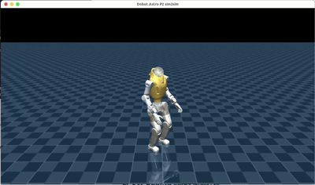
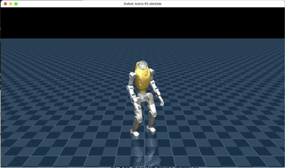
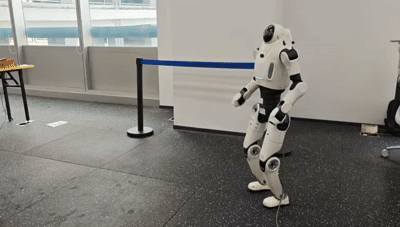
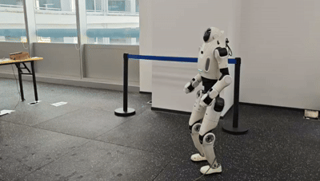
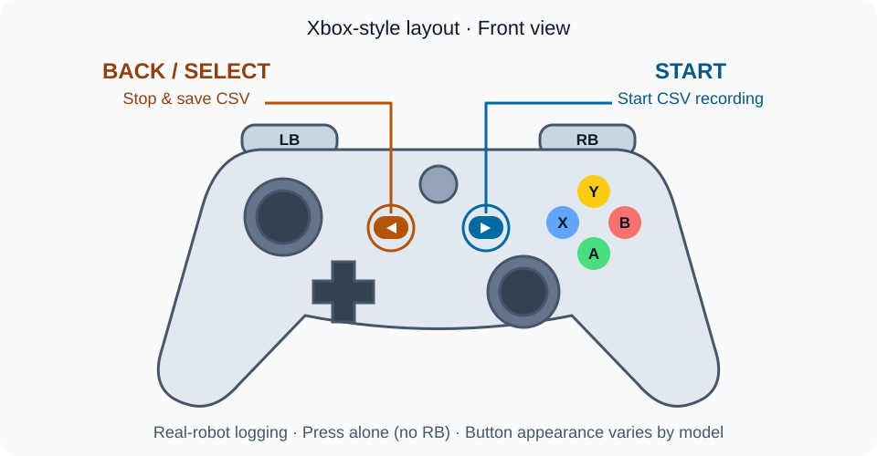

# Dobot Lumo P2 强化学习移动策略部署

中文 | [English](README.md)

本项目用于 Lumo P2 强化学习移动策略的部署与仿真。本文以 Ubuntu 22.04 为例介绍环境配置和使用方法，包含两种策略：

- `isaaclab_velocity_opensource`
- `mjlab_velocity`

项目提供 MuJoCo sim2sim 仿真，以及通过网线连接机器人后在用户电脑上运行的 sim2real 程序。用户不需要、也无法登录机器人主机。

Dobot 公开 SDK 使用单独仓库，不包含在本项目中。建议先完成仿真验证，再连接实机。

| isaaclab_velocity_sim2sim                             | mjlab_velocity_sim2sim                          |
| ----------------------------------------------------- | ----------------------------------------------- |
|                         |                       |
| **isaaclab_velocity_sim2real**                        | **mjlab_velocity_sim2real**                     |
|  |  |

## 1. 项目目录

```text
assets/        MuJoCo 模型与 mesh
models/        两份 ONNX 策略
scripts/       依赖准备、构建和运行脚本
src/           仿真与实机程序
tests/         无硬件测试
```

以下命令如无特殊说明，均在项目根目录执行：

```bash
cd lumo_p2_locomotion_deploy
```

## 2. 安装基础环境（以 Ubuntu 22.04 为例）

```bash
sudo apt update
sudo apt install -y \
  build-essential cmake curl git iproute2 iputils-ping \
  libgl1-mesa-dev xorg-dev
```

这些软件包分别提供 C/C++ 构建工具、依赖下载工具、网络检查工具，以及 MuJoCo 窗口所需的 OpenGL/X11 开发文件。

确认环境：

```bash
cmake --version
c++ --version
uname -m
```

`uname -m` 必须输出 `x86_64`。本项目仅支持在 x86_64 Linux 用户电脑上构建和运行。

## 3. 配置项目依赖

依赖包括 Eigen 3.4.0、ONNX Runtime 1.20.1、MuJoCo 3.2.6 和 GLFW 3.4。选择下面任意一种方式即可，不需要两种都执行。

### 方式一：运行项目脚本（推荐）

```bash
./scripts/setup_deps.sh
```

脚本会下载固定版本并安装到：

```text
.deps/linux-x64/
├── include/
└── lib/
```

编译前在当前终端设置依赖路径：

```bash
export LUMO_DEPS_ROOT="$PWD/.deps/linux-x64"
```

该变量只对当前终端生效。每次打开新终端需要重新执行。

### 方式二：从官网下载压缩包

下载以下压缩包：

- [Eigen 3.4.0](https://gitlab.com/libeigen/eigen/-/releases/3.4.0)
- [ONNX Runtime 1.20.1](https://github.com/microsoft/onnxruntime/releases/tag/v1.20.1)，选择 `linux-x64`
- [MuJoCo 3.2.6](https://github.com/google-deepmind/mujoco/releases/tag/3.2.6)，选择 `linux-x86_64`
- [GLFW 3.4](https://github.com/glfw/glfw/releases/tag/3.4)

假设压缩包位于 `~/Downloads`，执行：

```bash
mkdir -p "$PWD/.deps/linux-x64/include/eigen3" \
  "$PWD/.deps/linux-x64/lib"
export LUMO_DEPS_ROOT="$PWD/.deps/linux-x64"

tar -xzf "$HOME/Downloads/eigen-3.4.0.tar.gz" -C /tmp
cp -a /tmp/eigen-3.4.0/Eigen /tmp/eigen-3.4.0/unsupported \
  "$LUMO_DEPS_ROOT/include/eigen3/"

tar -xzf "$HOME/Downloads/onnxruntime-linux-x64-1.20.1.tgz" -C /tmp
cp -a /tmp/onnxruntime-linux-x64-1.20.1/include/. \
  "$LUMO_DEPS_ROOT/include/"
cp -a /tmp/onnxruntime-linux-x64-1.20.1/lib/. \
  "$LUMO_DEPS_ROOT/lib/"

tar -xzf "$HOME/Downloads/mujoco-3.2.6-linux-x86_64.tar.gz" -C /tmp
cp -a /tmp/mujoco-3.2.6/include/. "$LUMO_DEPS_ROOT/include/"
cp -a /tmp/mujoco-3.2.6/lib/. "$LUMO_DEPS_ROOT/lib/"

tar -xzf "$HOME/Downloads/3.4.tar.gz" -C /tmp
cmake -S /tmp/glfw-3.4 -B /tmp/glfw-build \
  -DCMAKE_BUILD_TYPE=Release \
  -DCMAKE_INSTALL_PREFIX="$LUMO_DEPS_ROOT" \
  -DBUILD_SHARED_LIBS=ON \
  -DGLFW_BUILD_EXAMPLES=OFF \
  -DGLFW_BUILD_TESTS=OFF \
  -DGLFW_BUILD_DOCS=OFF \
  -DGLFW_BUILD_WAYLAND=OFF \
  -DGLFW_BUILD_X11=ON
cmake --build /tmp/glfw-build -j"$(nproc)"
cmake --install /tmp/glfw-build
```

检查关键文件：

```bash
test -f "$LUMO_DEPS_ROOT/include/eigen3/Eigen/Core"
test -f "$LUMO_DEPS_ROOT/include/mujoco/mujoco.h"
test -f "$LUMO_DEPS_ROOT/include/onnxruntime_cxx_api.h"
test -e "$LUMO_DEPS_ROOT/lib/libglfw.so"
test -e "$LUMO_DEPS_ROOT/lib/libmujoco.so"
test -e "$LUMO_DEPS_ROOT/lib/libonnxruntime.so"
```

所有命令无输出表示文件存在。

## 4. 编译和运行 MuJoCo sim2sim 仿真

设置依赖路径并编译：

```bash
export LUMO_DEPS_ROOT="$PWD/.deps/linux-x64"
./scripts/build_sim.sh
```

脚本会构建 `lumo_sim`，并检查状态机、两份 ONNX 模型和 MuJoCo 场景。成功时应看到：

```text
100% tests passed
```

启动仿真：

```bash
./scripts/run_sim.sh
```

只检查模型和场景、不打开窗口：

```bash
./build-sim/lumo_sim --check
```

### 仿真按键

| 操作 | 功能 |
|---|---|
| `RB + Y` | 重置物理场景，保持当前 mode 不变 |
| `RB + A` | 任意状态进入初始位姿，插值约 2 秒 |
| `RB + X` | 任意状态进入阻尼模式 |
| `RB + ↑` | 初始位姿完成后进入 IsaacLab 策略，或从 MJLab 切换 |
| `RB + ↓` | 初始位姿完成后进入 MJLab 策略，或从 IsaacLab 切换 |
| 左摇杆 | 前后、左右速度 |
| 右摇杆 | 转向速度 |

机器人已经倒地时，按以下顺序操作：

1. 按 `RB + A` 进入 `initial_pose`，等待约 2 秒。
2. 按 `RB + Y` 重置场景，使机器人重新站立；当前 mode 仍为 `initial_pose`。
3. 按 `RB + ↑` 或 `RB + ↓` 进入策略。

没有手柄时，可按住 `R` 代替 `RB`：

- `R+Y` 重置场景，`R+A`、`R+X`、`R+↑`、`R+↓` 切换状态。
- `W/S` 控制前后，`A/D` 控制左右，`Q/E` 控制转向。

## 5. 准备本机 sim2real 环境

### 5.1 准备独立 Dobot 公开 SDK

使用公开的 `dobot-sdk` 仓库中的 x86_64 库，要求 GLIBC ≥ 2.34、GLIBCXX ≥ 3.4.30，本文示例使用 Ubuntu 22.04。假设 SDK 位于：

```text
/absolute/path/to/dobot-sdk/
```

至少应包含：

```text
CMakeLists.txt
include/dobot/sdk/session.hpp
include/dobot/robot/sr_3588/
include/dobot/robot/sr_thro/
lib/x86_64/libdobot_sdk.a
lib/x86_64/libdobot_log.so
thirdparty/include/
thirdparty/lib/x86_64/
```

设置 SDK 路径：

```bash
export LUMO_SDK_ROOT=/absolute/path/to/dobot-sdk
```

SDK 仍然独立维护，不要复制到本项目或提交到 Git。构建时通过 SDK 自带的 CMake target 链接其匹配版本的 Fast DDS / Fast CDR / 日志库；不再使用旧版 Bridge SDK。

### 5.2 使用网线连接机器人

将用户电脑通过网线连接到机器人。本项目默认机器人地址为 `192.168.5.2`：

```bash
ping -c 3 192.168.5.2
```

如果无法连通，请在 Ubuntu 网络设置中把有线网卡配置到 `192.168.5.0/24` 同一网段，例如电脑使用 `192.168.5.100`、子网掩码使用 `255.255.255.0`，不要占用机器人地址。

可以用下面的命令检查系统选择了哪块网卡：

```bash
ip route get 192.168.5.2
```

输出中的 `dev` 后面是网卡名，例如 `enp8s0`。`run_real.sh` 会根据机器人 IP 自动选择这块网卡，无需在编译时配置。

如果其他版本的机器人使用不同地址，可在启动时通过 `--robot-ip` 指定，详见第 6 节。只有自动选择结果不正确时，才需要用 `LUMO_DDS_INTERFACE=enp8s0` 手动指定有线网卡。

### 5.3 在用户电脑编译实机程序

```bash
export LUMO_DEPS_ROOT="$PWD/.deps/linux-x64"
export LUMO_SDK_ROOT=/absolute/path/to/dobot-sdk
./scripts/build_real.sh
```

`build_real.sh` 只在本机生成 `build-real/lumo_real`，然后执行不连接硬件的 `--check`。它不会启动机器人控制。

## 6. 启动实机程序

启动前必须满足：

- 机器人已可靠支撑，急停可用，周围无人。
- 机器人已做必要的保护措施。
- 机器人已进入允许外部 DDS 关节控制的调试状态。
- 没有其他程序同时下发关节指令。
- 有线网络已按上一节配置，用户电脑能够访问机器人 IP。
- 网线连接必须牢固且可靠，避免断连风险。
- 电脑及网卡性能充足，避免因性能不足引起通信频率下降。

### 6.1 启动程序

推荐使用 `sudo` 启动实机程序。公开 SDK 会为 DDS 通信线程申请 `SCHED_FIFO`、优先级 `50`；普通用户权限不足时会出现 `Problem to set scheduler ... Operation not permitted`。在普通 Ubuntu 主机上，`sudo` 通常可提供所需权限，无需另行配置用户实时优先级限制。编译仍使用普通用户。

在终端中执行：

```bash
sudo ./scripts/run_real.sh
```

此命令默认选择 `sr_3588`（`192.168.5.2`），并根据路由自动选择有线网卡。选择 SR_thro 时，默认地址随之变为 `172.16.20.2`：

```bash
sudo ./scripts/run_real.sh --model sr_thro
```

显式覆盖机器人地址：

```bash
sudo ./scripts/run_real.sh --robot-ip 192.168.10.2
```

也可以通过 `sudo env` 显式传入环境变量，避免被 `sudo` 默认环境过滤；命令行参数的优先级更高：

```bash
sudo env LUMO_ROBOT_IP=192.168.10.2 ./scripts/run_real.sh
```

可用 `--nic enp8s0 --domain 0` 显式设置网卡和 DDS domain；环境变量对应为 `LUMO_ROBOT_MODEL`、`LUMO_DDS_INTERFACE`、`LUMO_DDS_DOMAIN`，命令行优先。

用户须先手动切入调试模式，程序不切模式、不使能电机。`--robot-ip` 用于选择路由和配置 RPC；DDS 通过网卡/domain发现对端，不限定该 IP，应使用单机器人独立网段/domain。

程序启动后处于阻尼模式，收到新鲜状态并匹配上下肢命令读者后才发送指令。停止时先按 `RB + X`，再按 `Ctrl+C`，并等待：

```text
[STOPPED] 程序已退出 / LUMO CONTROL STOPPED
```

运行期间保持终端开启，停止程序按第7节操作。使用 `sudo` 解决的是调度权限问题，不保证500 Hz控制周期，也不直接解决 `missing/stale SDK topic(s)` 数据超时。

### 6.2 实机按键



上图为 Xbox 布局手柄的正面示意。**Back / Select 是中央偏左的小按键，Start 是中央偏右的小按键**；部分型号分别标为 View 和 Menu。不同型号的外观可能不同，请使用 Xbox 模式下对应的按键。

| 操作 | 功能 |
|---|---|
| `RB + A` | 任意状态进入初始位姿，插值约 2 秒 |
| `RB + X` | 任意状态进入阻尼模式 |
| `RB + ↑` | 初始位姿完成后进入 IsaacLab 策略，或从 MJLab 切换 |
| `RB + ↓` | 初始位姿完成后进入 MJLab 策略，或从 IsaacLab 切换 |
| 左摇杆 | 前后、左右速度 |
| 右摇杆 | 转向速度 |
| `Start` | 开始记录电机调试 CSV |
| `Back / Select` | 停止记录并保存 CSV，不停止机器人控制 |

先按 `RB + A` 进入 `initial_pose`，等待插值完成，再将机器人从吊机放下，使双脚接触地面。随后按 `RB + ↑` 或 `RB + ↓` 进入策略。

两个策略运行时可以直接互相切换，但必须保持站立，严禁行走中切换。

### 6.3 记录与调试： CSV 与 PlotJuggler 查看

程序运行并收到有效机器人状态后，按一下 `Start` 开始记录，按一下 `Back / Select` 停止并保存。按住按键不会重复创建文件；同时按下时 Back 优先。记录中再次按 Start 不重开文件。等待终端出现 `[CSV] Saved / 已保存` 后，再按 Start 可开始新的一段记录。

CSV 保存在项目目录的 `logs/csv/`，例如 `lumo_20261104T103000Z_a1B2c3.csv`（文件名时间为 UTC，随机后缀避免覆盖）。开始和保存时会打印完整路径、保存行数及丢弃样本数。使用 `sudo` 记录的 CSV 设置为所有用户可读，可直接用普通用户运行的 PlotJuggler 打开。`logs/` 已由 Git 忽略。

每个控制周期尝试采集一行，目标频率500 Hz，时间使用本机单调时钟的实际经过秒数；记录的是控制循环读到的最新状态，不代表每行都是新的 DDS 帧。记录列如下：

| 列 | 含义 |
|---|---|
| `time_s` | 从本次 Start 开始经过的秒数，作为绘图时间轴 |
| `sample_index` / `dropped_samples` | 采样序号 / 本次记录累计队列溢出丢样数 |
| `mode` | 0=阻尼，1=初始位姿，2=IsaacLab，3=MJLab |
| `command_written` | 本周期上下肢命令是否都成功交给本地 DDS；不代表机器人执行确认 |
| `<关节名>/q_rad` / `dq_rad_s` | 位置 / 速度反馈 |
| `<关节名>/tau_est_nm` | SDK 的 `tau_est` 估计力矩反馈，不宣称为力矩传感器实测值 |
| `<关节名>/q_cmd_rad` / `dq_cmd_rad_s` | 本周期下发的目标位置 / 速度 |
| `<关节名>/tau_ff_cmd_nm` | 下发的前馈力矩，不包含机器人内部 PD 项 |
| `<关节名>/kp` / `kd` | 下发的 PD 增益 |

在 PlotJuggler 中使用 **Load data from file** 打开 CSV，分隔符选择逗号，第一行为列名，选择数值列 `time_s` 作为时间轴。将 `left_knee_joint/q_rad` 和 `left_knee_joint/q_cmd_rad` 拖到同一图比较跟踪效果，将 `left_knee_joint/tau_est_nm` 拖到另一图查看估计力矩；其他关节同理。导入流程见 [PlotJuggler 作者的 CSV 示例](https://slides.com/davidefaconti/plotjuggler-data)。

采样使用固定容量队列，CSV 格式化和写盘由独立线程完成；磁盘跟不上时丢弃新样本，保存时明确提示丢样数，时间轴和采样序号保留间断。正常 `Ctrl+C` 或检测到断连退出时，会在退出阻尼尝试后自动保存已采集数据；退出阻尼的20次写入不加入 CSV。强制杀进程或掉电不能保证最后的数据完整。写盘失败会显示 `[ERROR] CSV RECORDING FAILED` 并禁用本进程后续记录，不改变机器人控制模式。

## 7. 终止实机程序

先按 `RB + X` 进入阻尼模式，再在运行程序的终端按 `Ctrl+C`。等待程序输出以下信息并返回命令提示符：

```text
[STOPPED] 程序已退出 / LUMO CONTROL STOPPED
```

## 8. 更换策略

模型文件位于：

```text
models/isaaclab_velocity_opensource/policy.onnx
models/mjlab_velocity/policy.onnx
```

固定接口为：

- IsaacLab：`obs[1,480] -> actions[1,29]`
- MJLab：`obs[1,98] -> actions[1,29]`

替换模型时，输入输出名称和维度、观测排列与历史、关节顺序、默认位姿、PD 增益和 action scale 必须全部一致。替换后重新启动对应程序。

## 9. 常见问题

### 提示没有设置依赖或 SDK 变量

```bash
export LUMO_DEPS_ROOT="$PWD/.deps/linux-x64"
export LUMO_SDK_ROOT=/absolute/path/to/dobot-sdk
```

每个新终端都需要重新设置这两个编译变量。机器人 IP 和网卡在启动时配置，不需要重新编译。

### 网线连接后无法 ping 通机器人

```bash
ip -brief address
ip route get 192.168.5.2
ping -c 3 192.168.5.2
```

检查网线、网卡状态、本机地址和子网掩码，确保电脑与机器人处于同一网段。如果机器人并非默认地址，请将命令中的地址替换为实际地址，并使用 `sudo ./scripts/run_real.sh --robot-ip 实际地址` 启动。

### 运行中断连或异常退出

状态超时、命令发送失败等故障会立即打印带分隔线的 `[ERROR] 控制已中止 / CONTROL ABORTED` 提示，并在 SDK 对象清理后再次打印 `[ERROR] 异常退出 / LUMO CONTROL FAILED`、原始故障原因及非零退出码。交互终端使用红色加粗；重定向日志保留醒目的纯文本标题，设置 `NO_COLOR` 可禁用颜色。

正常按 `Ctrl+C` 退出使用黄色 `[STOPPED]` 提示，与故障退出区分。退出摘要记录阻尼写入尝试及本地失败次数；即使本地写入成功，也不代表机器人执行成功，断网时阻尼可能无法送达。`Dobot logger shutting down...` 只是 SDK 日志清理信息，应查看 `[ERROR]` 中的原因。

### 程序一直等待 SDK 状态

确认：

- 启动时显示的 `FastDDS interface` 是实际连接机器人的网卡，而不是无线网卡；如自动选择错误，可用 `sudo env LUMO_DDS_INTERFACE=enp8s0 ./scripts/run_real.sh` 覆盖。
- 机器人已经进入允许外部 DDS 控制的状态。
- SDK 的 x86_64 库与本机系统及运行库版本匹配。
- 没有防火墙或其他程序阻断、占用 DDS 通信。

修改机器人 IP、型号、网卡或 domain 后无需重新编译，下一次启动会传入新的 Session 配置，不生成运行时 XML。

首次等待超过10秒会退出；运行中关节/IMU超过100 ms、手柄超过500 ms没有新数据会停止策略，尝试发送阻尼后退出。检查日志中的具体话题及固件发布频率。断链时无法保证阻尼送达，机器人端 watchdog 行为仍需确认。

### 仿真窗口打不开

```bash
echo "$DISPLAY"
```

无输出表示当前终端没有图形桌面。可以先运行 `./build-sim/lumo_sim --check`。

### 手柄没有响应或键位错乱

```bash
ls /dev/input/js* /dev/input/event* 2>/dev/null
```

确认手柄已被正确识别，请使用 Xbox 标准协议手柄，或将手柄切换为 Xbox 模式。仿真也可以使用键盘。

## 10. 安全说明

- 策略必须先完成 MuJoCo 验证，再连接实机。
- 首次实机运行必须可靠支撑机器人，并保持急停可用。
- 从阻尼模式开始，先进入初始位姿，再启动策略。
- 初次测试只使用很小的速度指令。
- 姿态、方向或通信异常时，立即使用 `RB + X` 或急停。
- 关闭程序前务必先使用 `RB + X` 进入阻尼模式。
- 不得与其他下发关节指令的程序同时运行。
- 必须保证网线的连接可靠，网线已紧固到位，无断连风险。
